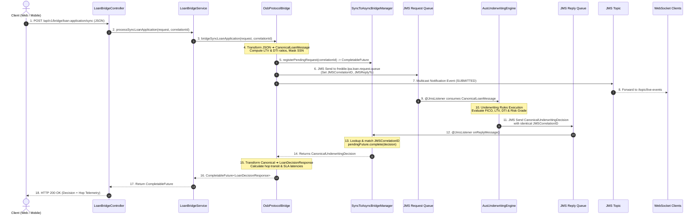
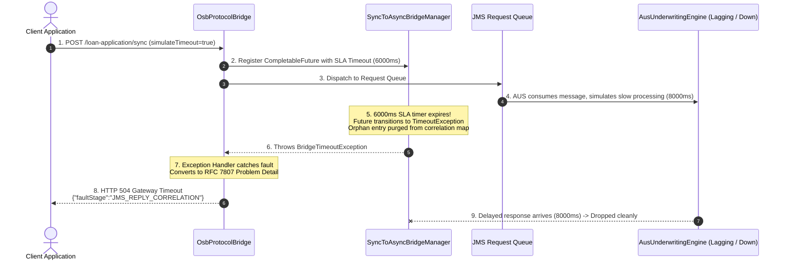
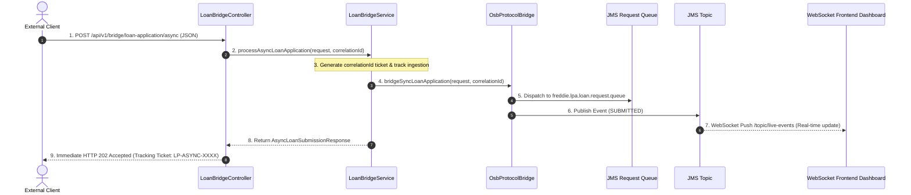

# OSB Protocol Bridge Pattern Realtime Application

Real-time enterprise application built with **Java 21**, **Spring Boot 3.3.4**, and **Apache ActiveMQ Artemis**, demonstrating the **OSB Protocol Bridge Pattern** for synchronous-to-asynchronous request-reply messaging, enterprise data transformation, and real-time event streaming.

---

## 🏛️ Architecture & Application Overview

### Executive Summary
The **Protocol Bridge Pattern** originates from Service-Oriented Architecture (SOA) and **Oracle Service Bus (OSB)** / Enterprise Service Bus (ESB) paradigms. It solves the impedance mismatch between two disparate systems that speak **incompatible transport protocols, communication styles, or payload schemas**:

- **Consumer Side**: Modern web, mobile, and API-first clients expect lightweight, synchronous **HTTP/1.1 REST (JSON)** or real-time event streaming via **WebSocket (STOMP)** with millisecond response guarantees.
- **Enterprise Provider Side**: Core transactional systems (e.g., mortgage automated underwriting engines, credit bureaus, core banking ledger mainframes) communicate over reliable, queue-based **asynchronous messaging transports (JMS, Apache ActiveMQ, IBM MQ)**.

This application implements a complete, production-grade protocol bridge inspired by **Freddie Mac's Loan Product Advisor (LPA) / Automated Underwriting System (AUS)**. It enables front-facing loan origination portals to submit loan applications synchronously over REST, bridges the requests onto enterprise JMS queues with dynamic `JMSCorrelationID` tracking, executes underwriting risk evaluation, and correlates the response back into an immediate `HTTP 200 OK` client response.

---

### High-Level Architecture Diagram

```
                                    OSB PROTOCOL BRIDGE (SPRING BOOT 3)
┌──────────────────────┐          ┌────────────────────────────────────────────────────────┐
│                      │          │                                                        │
│  Client Applications │          │  ┌──────────────────────┐    ┌──────────────────────┐  │
│  (Web / Mobile / UI) │          │  │ Inbound HTTP Adapter │    │ Service Layer        │  │
│                      │          │  │ (LoanBridgeController│───►│ (LoanBridgeService)  │  │
└──────────┬───────────┘          │  └──────────────────────┘    └──────────┬───────────┘  │
           │                      │                                         │              │
           │ 1. HTTP POST (JSON)  │                                         ▼              │
           │    /loan-application │  ┌──────────────────────┐    ┌──────────────────────┐  │
           │                      │  │ Protocol Transformer │    │ OsbProtocolBridge    │  │
           │ 8. HTTP 200 (JSON)   │  │ (JSON ⇄ Canonical)   │◄───│ (JMS Request / Reply)│  │
           │    Decision + Metrics│  └──────────────────────┘    └──────────┬───────────┘  │
           ▼                      │                                         │              │
┌──────────────────────┐          └─────────────────────────────────────────┼──────────────┘
│ Real-Time Cockpit    │                                                    │
│ Web Dashboard        │                                     (JMS Request)  │  (JMS Reply)
│ (Port 8080)          │                                                    ▼              │
└──────────▲───────────┘                                        ┌──────────────────────────┴─┐
           │                                                    │   Embedded Artemis Broker  │
           │ 9. STOMP Event Push                                │ ────────────────────────── │
           │    /topic/live-events                              │ • freddie.lpa.loan.request │
           │                                                    │ • freddie.lpa.loan.reply   │
┌──────────┴───────────┐                                        │ • freddie.lpa.notification │
│ JmsToWebSocketBridge │◄───────────────────────────────────────┤   (Pub-Sub Topic)          │
│ (Topic ➔ WebSocket)  │   JMS Multicast Event                  └─────────────┬──────────────┘
└──────────────────────┘                                                      │
                                                                              │ 4. @JmsListener
                                                                              ▼
                                                                ┌────────────────────────────┐
                                                                │  AusUnderwritingEngine     │
                                                                │  (LPA Underwriting Core)   │
                                                                │  • LTV, DTI, FICO Rules    │
                                                                │  • Risk Rating & Rates     │
                                                                └────────────────────────────┘
```

---

## 🔧 How the OSB Protocol Bridge Pattern is Used in This Application

In traditional Oracle Service Bus (OSB) configurations, the Protocol Bridge bridges transports across **Proxy Services**, **Pipeline Actions**, and **Business Services**. This Java application maps each OSB construct into clean, idiomatic Spring Boot, Service Layer, and JMS abstractions:

| OSB Concept | Application Component | Responsibility & Implementation |
| :--- | :--- | :--- |
| **Inbound Proxy Service** | [`LoanBridgeController`](src/main/java/com/hexaware/protocolbridge/controller/LoanBridgeController.java) | Terminates inbound HTTP REST connections, validates payload constraints (`@Valid`), extracts client headers (`X-Correlation-ID`), and delegates directly to the Service Layer without executing business/messaging methods directly. |
| **Business Service Layer** | [`LoanBridgeService`](src/main/java/com/hexaware/protocolbridge/service/LoanBridgeService.java) / [`LoanBridgeServiceImpl`](src/main/java/com/hexaware/protocolbridge/service/impl/LoanBridgeServiceImpl.java) | Decouples the presentation controller from low-level bridge orchestration. Coordinates synchronous & asynchronous loan application workflows, correlation IDs, audit querying, and active metrics collation. |
| **Pipeline Request Actions** | [`ProtocolTransformer`](src/main/java/com/hexaware/protocolbridge/bridge/ProtocolTransformer.java) | Replaces OSB XQuery/XSLT transformations. Translates client JSON into the Canonical Enterprise format ([`CanonicalLoanMessage`](src/main/java/com/hexaware/protocolbridge/model/CanonicalLoanMessage.java)), computes business metrics (LTV and DTI ratios), and masks sensitive data (SSN). |
| **Transport Protocol Switch** | [`OsbProtocolBridge`](src/main/java/com/hexaware/protocolbridge/bridge/OsbProtocolBridge.java) | Switches transport protocol from HTTP to JMS. Stamps transport headers (`X_SOURCE_PROTOCOL`, `X_TARGET_ENGINE`, `X_INGRESS_TIMESTAMP`) and enqueues onto `freddie.lpa.loan.request.queue`. |
| **Request-Reply Correlator** | [`SyncToAsyncBridgeManager`](src/main/java/com/hexaware/protocolbridge/bridge/SyncToAsyncBridgeManager.java) | Registers a non-blocking `CompletableFuture` in a thread-safe registry keyed by `JMSCorrelationID`. When the reply listener receives a decision on `freddie.lpa.loan.reply.queue`, it correlates the message and completes the waiting future. |
| **Pipeline Response Actions** | [`ProtocolTransformer`](src/main/java/com/hexaware/protocolbridge/bridge/ProtocolTransformer.java) | Transforms backend canonical decisions ([`CanonicalUnderwritingDecision`](src/main/java/com/hexaware/protocolbridge/model/CanonicalUnderwritingDecision.java)) back into outward REST DTO ([`LoanDecisionResponse`](src/main/java/com/hexaware/protocolbridge/model/LoanDecisionResponse.java)), computing transit latencies and hop summaries. |
| **Topic-to-WebSocket Bridge** | [`JmsToWebSocketBridge`](src/main/java/com/hexaware/protocolbridge/bridge/JmsToWebSocketBridge.java) | Subscribes to JMS multicast topics (`freddie.lpa.notifications.topic`) and bridges lifecycle events onto WebSocket STOMP (`/topic/live-events`). |
| **Fault & SLA Bridging** | [`GlobalBridgeExceptionHandler`](src/main/java/com/hexaware/protocolbridge/controller/GlobalBridgeExceptionHandler.java) | Translates internal messaging failures and timeouts into RFC 7807 standardized Problem Details (`504 Gateway Timeout`, `502 Bad Gateway`). |

---

## 🔄 Detailed Functional Flows

### Flow 1: Synchronous Request-Reply Protocol Bridge (End-to-End Decisioning)

This is the primary flow where a synchronous HTTP client receives an immediate underwriting decision mediated across asynchronous queues:



**Step Breakdown**:
1. **HTTP Ingress**: Client submits `LoanApplicationRequest` (e.g., $380,000 loan, $500,000 property value, 775 FICO).
2. **Service Layer Mediation**: `LoanBridgeController` delegates to `LoanBridgeService.processSyncLoanApplication(...)`.
3. **Payload & Canonical Transformation**: The bridge calculates LTV (76.0%) and DTI (19.31%), creates a canonical enterprise object, and generates correlation ID (e.g., `LP-A2CCCFAF`).
4. **Correlation Waiter Registration**: The bridge registers an asynchronous `CompletableFuture` with a 6,000ms SLA timeout.
5. **JMS Dispatch**: Enqueued to `freddie.lpa.loan.request.queue` with transport properties (`X_SOURCE_PROTOCOL=HTTP_REST`).
6. **Backend Processing**: `AusUnderwritingEngine` simulates core Freddie Mac LPA rules, determines risk tier (`ACCEPT - LOW_RISK_PRIME`), sets base rate (6.125%), and produces conditions.
7. **Reply & Correlation Matching**: The decision is published to `freddie.lpa.loan.reply.queue`. The bridge listener matches `JMSCorrelationID` and wakes up the waiting HTTP caller thread.
8. **Response Transformation & Egress**: Returns `HTTP 200 OK` with full decision details and hop latency breakdown (`totalBridgeLatencyMs`, `backendProcessingMs`, `queueHopTransitMs`).

---

### Flow 2: SLA Timeout & Fault Bridging Flow

When backend processing exceeds the agreed SLA timeout (or the backend engine is down), the bridge gracefully recovers and produces an RFC 7807 problem detail response:



---

### Flow 3: Asynchronous Ingestion & WebSocket Event Streaming Flow

For high-volume burst ingestion where callers do not wait synchronously:



---

## 📌 Under Which Scenarios Is It Used?

| Scenario | Use Case in Enterprise | Benefit of Protocol Bridge Pattern |
| :--- | :--- | :--- |
| **1. Synchronous REST API to Asynchronous Messaging** | Mobile apps, web portals, or third-party partner APIs require synchronous HTTP request-reply, while backend core services communicate over JMS or IBM MQ. | Provides synchronous semantics over asynchronous brokers without blocking OS threads, using dynamic correlation IDs and timeout guards. |
| **2. Real-Time Mortgage & Banking Decisioning** | Freddie Mac Loan Product Advisor (LPA), Automated Underwriting Systems (AUS), loan pricing, and credit decisioning engines. | Transforms diverse borrower JSON payloads into standard MISMO/Canonical XML/JSON models, mediating decisions with legacy decision rule systems. |
| **3. Traffic Spike Absorption & Load Leveling** | Flash sales, rate-drop refinancing surges, or monthly payment processing bursts. | Queues absorb bursts of traffic, preventing backend databases and transaction engines from crashing under direct synchronous concurrency spikes. |
| **4. DMZ & Network Security Boundary Isolation** | Secure banking intranet zones that forbid direct public inbound TCP/JMS connections. | The Protocol Bridge runs in the DMZ proxy layer, terminating external HTTPS connections and bridging securely over internal enterprise message queues. |
| **5. Legacy Modernization & Heterogeneous Bridging** | Incrementally modernizing monolithic services from SOAP/XML or JMS to REST/JSON or gRPC. | Allows frontend clients to adopt modern REST/JSON contracts without requiring legacy backends to be rewritten simultaneously. |
| **6. Real-Time Event Notification Streaming** | Live loan status updates, approval alerts, trade execution feeds. | Subscribes to backend JMS pub-sub topics and bridges events onto WebSocket STOMP streams for instant frontend dashboard updates. |

---

## 🚀 Quick Start & How to Run

### Prerequisites
- **Java 21** or later
- **Maven 3.9+**

### 1. Build and Run the Application
```bash
# Navigate to the project directory
cd OSB_Protocal_Bridge_Pattern_Realtime_App

# Run full integration test suite
mvn test

# Package the application
mvn clean package

# Start the Spring Boot application
mvn spring-boot:run
```

### 2. Access the Real-Time Web Cockpit
Open your browser and navigate to:
```
http://localhost:8080
```

The interactive cockpit provides:
- **Interactive Hop Visualizer**: Real-time packet animation moving through each stage: `Client -> Inbound Adapter -> Bridge -> Request Queue -> AUS Engine -> Reply Queue -> Outbound Adapter`.
- **Pre-configured Scenario Presets**:
  - `Conforming Prime (Auto Approve)`: FICO 775, LTV 76%, DTI 19% -> `ACCEPT - LOW_RISK_PRIME`
  - `High LTV / PMI (Refer Review)`: FICO 665, LTV 96%, DTI 44% -> `REFER_ELIGIBLE`
  - `High DTI > 50% (Decline)`: FICO 610, LTV 93%, DTI 56% -> `DECLINE - HIGH_DEBT_RISK`
  - `Simulate SLA Timeout`: Triggers >8s backend delay -> returns `HTTP 504 Gateway Timeout`
- **Live Metrics Telemetry**: Dynamic throughput, success rates, active correlation count, and latency counters.
- **Hop Audit Trail**: Chronological event logs with payload inspectors for every stage transition.

---

## 📡 API Reference & cURL Examples

### 1. Synchronous Loan Evaluation Bridge
- **Endpoint**: `POST /api/v1/bridge/loan-application/sync`
- **Headers**: `Content-Type: application/json`

```bash
curl -X POST http://localhost:8080/api/v1/bridge/loan-application/sync \
  -H "Content-Type: application/json" \
  -d '{
    "borrowerName": "Eleanor Vance",
    "borrowerSsn": "123-45-7890",
    "loanAmount": 380000.00,
    "propertyValue": 500000.00,
    "monthlyIncome": 14500.00,
    "monthlyDebt": 2800.00,
    "creditScore": 775,
    "loanPurpose": "PURCHASE",
    "propertyType": "SINGLE_FAMILY",
    "loanTermMonths": 360,
    "simulateTimeout": false
  }'
```

**Response (`HTTP 200 OK`)**:
```json
{
  "correlationId": "LP-A2CCCFAF",
  "evaluationReferenceId": "LPA-C8C03C82-E",
  "decisionStatus": "ACCEPT",
  "riskGrade": "LOW_RISK_PRIME",
  "approvedAmount": 380000.00,
  "recommendedRate": 6.125,
  "ltvPercentage": 76.00,
  "dtiPercentage": 19.31,
  "conditions": [
    "Standard borrower asset & income documentation.",
    "Property appraisal verification."
  ],
  "message": "Congratulations! Loan application automatically APPROVED by automated underwriting.",
  "bridgeHopSummary": {
    "clientProtocol": "HTTP/1.1 REST (JSON)",
    "enterpriseProtocol": "JMS 2.0 (Artemis Queue)",
    "requestQueue": "freddie.lpa.loan.request.queue",
    "replyQueue": "freddie.lpa.loan.reply.queue",
    "totalBridgeLatencyMs": 422,
    "backendProcessingMs": 363,
    "queueHopTransitMs": 59,
    "clientCompletedAt": "2026-10-12T09:43:01.476805300Z"
  }
}
```

### 2. SLA Timeout Fault Simulation
- **Endpoint**: `POST /api/v1/bridge/loan-application/sync` with `"simulateTimeout": true`

**Response (`HTTP 504 Gateway Timeout`)**:
```json
{
  "type": "https://hexaware.com/errors/bridge-timeout",
  "title": "Protocol Bridge SLA Timeout",
  "status": 504,
  "detail": "Gateway Timeout: Backend AUS Engine did not respond within SLA window for correlation LP-B55C95A2",
  "instance": "/api/v1/bridge/loan-application/sync",
  "timestamp": "2026-10-12T09:44:17.784672700Z",
  "faultStage": "JMS_REPLY_CORRELATION",
  "recommendation": "Retry with exponential backoff or use asynchronous bridging endpoint."
}
```

### 3. Asynchronous Loan Ingestion
- **Endpoint**: `POST /api/v1/bridge/loan-application/async`

**Response (`HTTP 202 Accepted`)**:
```json
{
  "status": "ACCEPTED_FOR_UNDERWRITING",
  "correlationId": "LP-ASYNC-DE70C7CF",
  "protocolTransition": "HTTP_REST -> JMS_QUEUE",
  "notificationChannel": "/topic/live-events",
  "timestamp": "2026-10-12T09:43:05.123Z"
}
```

### 4. Real-Time Telemetry Metrics
- **Endpoint**: `GET /api/v1/bridge/metrics`

```bash
curl http://localhost:8080/api/v1/bridge/metrics
```

**Response**:
```json
{
  "totalRequestsReceived": 2,
  "totalSuccessBridged": 1,
  "totalTimeouts": 1,
  "totalErrors": 0,
  "activePendingCorrelations": 0,
  "averageLatencyMs": 422.0,
  "minLatencyMs": 422,
  "maxLatencyMs": 422,
  "requestsByDecisionStatus": {
    "ACCEPT": 1
  },
  "uptimeSeconds": 363
}
```

---

## 📁 Project Structure

```
OSB_Protocal_Bridge_Pattern_Realtime_App/
├── pom.xml                                   # Spring Boot 3, Artemis JMS, Web & WebSocket dependencies
├── README.md                                 # Comprehensive documentation & functional guides
├── src/
│   ├── main/
│   │   ├── java/com/hexaware/protocolbridge/
│   │   │   ├── OsbProtocolBridgeApplication.java # Spring Boot application main class
│   │   │   ├── config/
│   │   │   │   ├── JmsConfig.java             # ConnectionFactory, Queues, Topics, MessageConverter
│   │   │   │   └── WebSocketConfig.java       # STOMP broker registry & endpoint config
│   │   │   ├── model/
│   │   │   │   ├── LoanApplicationRequest.java   # Inbound client REST DTO (JSON)
│   │   │   │   ├── CanonicalLoanMessage.java     # Enterprise Canonical Model (JMS Payload)
│   │   │   │   ├── CanonicalUnderwritingDecision.java # Backend AUS response payload
│   │   │   │   ├── LoanDecisionResponse.java     # Outbound client REST DTO (JSON)
│   │   │   │   ├── AsyncLoanSubmissionResponse.java # Asynchronous tracking ticket response DTO
│   │   │   │   ├── BridgeAuditLog.java           # Granular hop transition audit model
│   │   │   │   └── BridgeMetrics.java            # Operational telemetry snapshot
│   │   │   ├── service/
│   │   │   │   ├── LoanBridgeService.java        # Service layer contract
│   │   │   │   └── impl/
│   │   │   │       └── LoanBridgeServiceImpl.java # Business orchestration & decoupling
│   │   │   ├── bridge/
│   │   │   │   ├── OsbProtocolBridge.java        # Core Protocol Bridge orchestrator
│   │   │   │   ├── ProtocolTransformer.java      # JSON <-> Canonical payload transformer
│   │   │   │   ├── SyncToAsyncBridgeManager.java # Request-reply correlator & timeout manager
│   │   │   │   ├── JmsToWebSocketBridge.java     # Topic-to-WebSocket event streaming bridge
│   │   │   │   └── AuditAndMetricsService.java   # Real-time hop logger & metrics broadcaster
│   │   │   ├── backend/
│   │   │   │   └── AusUnderwritingEngine.java    # Freddie Mac LPA / AUS rule engine simulator
│   │   │   └── controller/
│   │   │       ├── LoanBridgeController.java     # Inbound HTTP proxy adapter endpoints
│   │   │       └── GlobalBridgeExceptionHandler.java # RFC 7807 Fault & timeout handler
│   │   └── resources/
│   │       ├── application.yml               # Artemis broker & queue configuration
│   │       └── static/
│   │           ├── index.html                # Real-time Web Cockpit UI
│   │           ├── css/styles.css            # Dark glassmorphic styling system
│   │           └── js/app.js                 # Interactive controls, animations & polling
│   └── test/
│       └── java/com/hexaware/protocolbridge/
│           ├── OsbProtocolBridgeIntegrationTest.java # End-to-end integration test suite
│           ├── controller/
│           │   └── LoanBridgeControllerTest.java     # Controller layer unit tests
│           └── service/
│               └── LoanBridgeServiceTest.java        # Service layer unit tests
```
